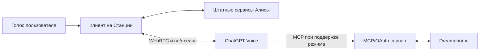

# Архитектура

`station/` получает обработанный микрофонный PCM от штатного сервиса устройства, кодирует Opus и воспроизводит ответ WebRTC. Штатная Алиса имеет приоритет. Отдельная локальная логика управляет сигналами состояния и окончанием ожидания; она не получает права на управление домом.

`home-control/` отделяет авторизацию ChatGPT от учётных данных поставщика. Устройства, комнаты и разрешения принадлежат конкретному подключённому аккаунту. Команда уборки комнаты не должна превращаться в уборку всего дома при неоднозначном результате.

Аккаунт ChatGPT, проект, Dreamehome и сервер задаются владельцем установки. В репозитории хранятся исходники и синтетические тестовые данные, а не состояние конкретного дома.

Веб-протокол Voice не является стабильным публичным API. Совпадение локальных тестов с ожидаемым форматом не гарантирует доступность функции в веб-сервисе. Результаты tool-вызовов и поддержка конкретной модели пылесоса проверяются отдельно.
